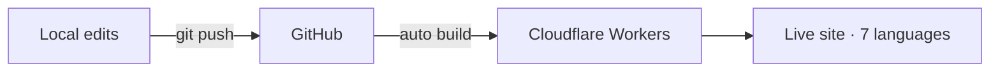

# Hi, I'm Henry Hu 👋

**Pre-sales Solution Architect · Global Expansion & AI Agent Solutions**

I help companies take enterprise software overseas — designing solutions that work across borders, languages and data protection regimes, and increasingly building them myself with AI agents.

- 🌏 Pre-sales for overseas and domestic markets in enterprise HR SaaS (recruitment cloud)
- 🎓 Studied at Monash University, Melbourne · first job in Singapore
- 🎤 Spoke as a global expansion expert at a market event in Dubai, UAE
- 🤖 Build solution prototypes, Skills and MCP integrations with Claude, Codex and other AI agent tools

---

## ⭐ Featured project: Compliance Checkup

**A cross-border recruitment data compliance checker covering 32 jurisdictions in 7 languages.**

🔗 **Live:** [compliance-checker.hengruihope.workers.dev](https://compliance-checker.hengruihope.workers.dev/?lang=en)

Paste a job application form or upload Word/PDF files. The tool detects which personal data fields are collected and tells you, market by market, whether each one is allowed, needs caution, is restricted (sensitive) or is prohibited — with the legal basis cited for every recommendation. It can then generate a DPIA draft as a Word document.

**What makes it different**

- **Privacy by design** — every document is parsed in the user's own browser; no candidate data ever reaches a server
- **Honest about its limits** — each jurisdiction is graded by how thoroughly it has been verified, from field-by-field checks to classification estimates
- **Built for real conversations with legal teams** — legal bases are cited per market, and DPIA drafts follow GDPR Art. 35(7) and ICO/EDPB templates
- **7 languages** — Simplified & Traditional Chinese, English, Vietnamese, Indonesian, Japanese and Arabic (full right-to-left layout)

**Real-world impact**

- Used in a cross-border project for a multinational telecom group covering 20 jurisdictions: the project had stalled for four weeks across several rounds of meetings; a field-by-field analysis and DPIA draft for the client's legal and security teams got it moving again
- Shared internally with pre-sales and delivery teams as a methodology for global compliance consulting

**How it was built and shipped**

- Iterated from v1.0 (manual checklist) to v4.1 (auto-detection, 32 jurisdictions, DPIA generation, 7 languages)
- Version control with Git, automated deployment on every push, one-command rollback
- Pre-launch security review: fixed an XSS issue in how uploaded content was rendered
- Only the public site folder is published; notes and changelog stay private
- Regression-tested so the multilingual rebuild produced output identical to the previous version

---

## 🧰 What I work with

**Domains:** global expansion · cross-border data compliance (GDPR, PIPL, PDPA, CCPA and more) · HR tech · ERP / CRM go-to-market

**Building:** AI agents (Claude, Codex) · MCP · HTML / JavaScript · Git & GitHub · Cloudflare

**Pre-sales:** solution architecture · demos and prototypes · technical workshops with client IT, security and legal teams

---

## 📫 Get in touch

- LinkedIn: [linkedin.com/in/hengrui-hu-821910118](https://www.linkedin.com/in/hengrui-hu-821910118)
- Email: hengruihope@163.com

中文简介

 

**胡恒瑞 · 技术型售前解决方案架构师 · 企业出海 & AI Agent 解决方案**

专注于帮助企业软件走向海外：设计能跨越国家、语言和数据保护法规的解决方案，并越来越多地借助 AI Agent 亲手把方案做出来。目前负责企业级 HR SaaS（招聘云）的海外及国内售前；曾就读于墨尔本莫纳什大学，第一份工作在新加坡；曾作为出海专家在阿联酋迪拜的市场活动上演讲。

代表作品「合规体检站」覆盖32个法域、支持7种语言，材料全部在用户浏览器本地解析，候选人数据不离开用户电脑；已在真实的跨境项目中帮助客户法务和安全团队推动停滞的项目继续前进。

